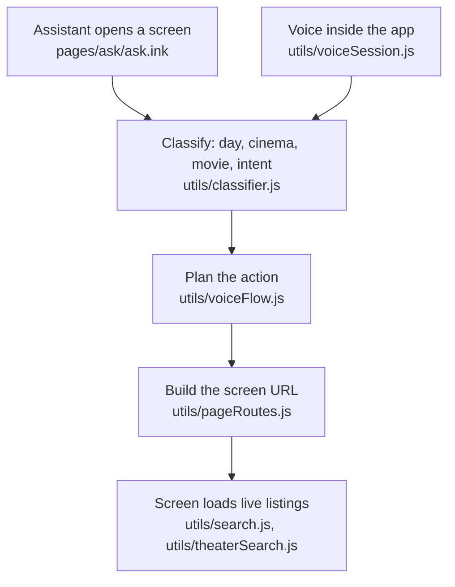

<p align="center">
  
</p>

<h1 align="center">Metro Manila Movie Locator</h1>

<p align="center">
  A hands-free cinema lookup app for Rokid AI glasses.<br>
  Ask where a movie is showing, what a cinema is playing, or which theaters are nearby.
</p>

<!-- Add a photo or short screen recording from the glasses here, for example:
<p align="center"></p>
-->

## What it does

| You say | You get |
|---|---|
| "Where can I watch Godzilla?" | The nearest cinemas showing it (up to five, within 20 km), with showtimes |
| "What's showing tomorrow?" | The movies playing that day |
| "What's playing at The Podium?" | That cinema's movies for the day |
| "Is Godzilla showing at Robinsons Galleria?" | Its showtimes there, or the nearest cinemas that do have it |
| "Nearest theaters" | The 15 closest cinemas with distances |

- **Flexible phrasing.** It looks for the movie, cinema and day inside a sentence instead of matching fixed commands. It also knows some Tagalog ("anong palabas bukas").
- **Forgiving names.** Short names ("Megamall", "MOA"), accents and words split by the speech recognizer are handled. When a name is close but not certain, the app asks "Did you mean…?".
- **Built for glasses.** Short lists, swipe to move, tap to select, double-tap to go back.
- **Location aware.** Results are sorted by distance. Without a location inside Metro Manila, it searches from Ortigas and says so on screen.

## How a request becomes a screen

The app runs on Rokid's AIUI (Ink) runtime, so there is no `index.html`. [`app.json`](app.json) lists the screens, each screen is a single `.ink` file, and the runtime starts it by calling `onLoad(query)`.

A request can arrive in two ways:

1. **Through the glasses' assistant**, which picks a screen from its description and passes parameters. The "Ask" screen takes the sentence word for word.
2. **By voice inside the app**, using the platform speech recognizer.

Both use the same parser:



You can watch this happen for any sentence, offline, against recorded data:

```console
$ node --no-warnings tools/traceRequest.mjs "is godzilla showing at the podium tomorrow"

phrase.js      toWords            ["is","godzilla","showing","at","the","podium","tomorrow"]
datePhrase.js  extractDate        {"date":"2026-11-18","tokens":["is","godzilla","showing","at","the","podium"]}
theaterPhrase  extractTheater     {"words":"at the podium","status":"match","theater":"The Podium"}
fillerWords    trimFiller         ["godzilla"]
titleMatch     resolveMovie       {"status":"match","title":"Godzilla Minus Zero"}
classifier     classifyOne        {"intent":"find", ... "confidence":0.95}
voiceFlow      planAction         {"type":"theater-movie","date":"2026-11-18"}
pageRoutes     routeFor           /pages/theater/theater?slug=the-podium&date=2026-11-18&movieId=21542
```

## Design decisions

- **Entities first, phrases second.** Listing every possible sentence does not scale. The classifier first finds the day, then a cinema from the live directory, then a movie from the live catalog, and only then uses signal words such as "nearest" or "showing".
- **Rules, not a model, inside the app.** Parsing is plain JavaScript with confidence levels, so each decision can be traced and tested. The assistant on the glasses is only relied on to open the app.
- **Ask rather than guess.** Uncertain or multiple matches lead to a choice screen. A request it cannot understand offers two useful options.
- **Tolerant of bad input.** The assistant sometimes sends missing parameters, literal `"null"` values or a cinema name in the movie field. Screens clean these up and forward the request to the right place.
- **Caching that matches how data changes.** Showtimes are cached for 1 minute, the movie list for 10 minutes and the cinema directory for a day. Failed requests are not cached.
- **Private by default.** Requests the app did not understand are saved only on the device (the last 20), for review on the Diagnostics screen.

## Project structure

```
app.json            Screens and permissions
AGENTS.md           Tells the glasses' assistant when and how to open the app
pages/
  movies/           Movies showing on a day (default screen)
  results/          Nearest cinemas and showtimes for a movie
  theaters/         Nearest cinemas
  theater/          One cinema's schedule, or a movie at that cinema
  choose/           "Did you mean…?" and "Which one?"
  ask/              Takes a free-form request and routes it
  diagnostics/      On-device checks for network, location and navigation
utils/              Parsing, matching, API, caching and formatting modules
tests/              Test suites, recorded API responses and a page test harness
tools/              Request tracer, phrase-set report and a development proxy
```

## Running it

**Tests** need only Node.js 22 or later. There are no dependencies to install and no network calls.

```bash
npm test
```

**The app** needs Rokid's `aix` CLI:

```bash
aix check .         # static checks
aix pack .          # build the .aix package
npm run preview     # preview in a desktop browser
```

The desktop preview is blocked by the API's CORS rules. To load live data there, run `npm run dev:proxy` and temporarily set the default `base` in [`utils/api.js`](utils/api.js) to `DEV_PROXY_BASE`. The glasses and AIUI Studio call the API directly.

## Testing

375 tests cover the parsing, matching, distance and date logic, and the screens themselves. [`tests/pageHarness.mjs`](tests/pageHarness.mjs) runs each screen's real script in Node with a mocked runtime, network and speech recognizer, so navigation and loading states can be tested without the glasses.

The phrase sets in `tests/corpus/` guard against regressions in understanding. They were written during development, so passing them is **not** a measure of accuracy on new wording or real speech:

```bash
node --no-warnings tools/evalIntents.mjs
```

## Limitations

- Metro Manila and nearby cities only.
- Listings come from [ClickTheCity](https://www.clickthecity.com)'s unofficial, undocumented API, which can change or block requests at any time. This project is not affiliated with or endorsed by ClickTheCity.
- Voice recognition needs a network connection and is set to English (`en-US`), so Tagalog recognition depends on what the recognizer returns.
- Whether the glasses' assistant opens this app, and which screen it picks, is controlled by the assistant and is not always consistent.
- No ticket booking, seat availability, reviews or trailers.
- Searching around a named place ("theaters near Malabon") is not supported yet.

## How it was built

I built this with AI assistance (Claude Code). I set the requirements, chose how the app should behave, tested it on the glasses and reported the problems that shaped the later fixes.
